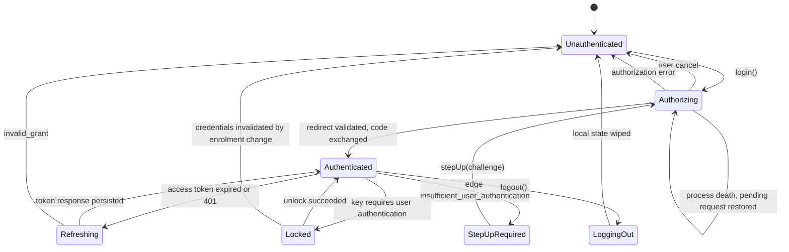

# Session state machine

Normative for every SDK. Android, iOS and Flutter implement *this* machine; they do not each
invent one. React Native would too, if built — it is last in the order agreed in #1 §1 and
conditional on demand, not yet a committed target, which is why it has no directory in #4's
layout and no required behaviour in `conformance/`. Where a platform cannot express a rule, the
deviation is recorded here rather than in platform code.

Grounded by issue #1. Conformance scenarios in [`conformance/`](conformance/) reference states
and transitions by the names used below.

## States

| State | Meaning |
|---|---|
| `Unauthenticated` | No usable grant. `login()` is the only meaningful call. |
| `Authorizing` | An authorization request is outstanding: the browser is open, or the app was killed while it was. |
| `Authenticated` | A refresh token is held and an access token is available or derivable. |
| `Refreshing` | A token request is in flight. Concurrent callers coalesce onto it; they do not each enter this state. |
| `StepUpRequired` | Edge refused a call with `insufficient_user_authentication`. The grant is valid; its authentication context is not sufficient. |
| `Locked` | Credentials are present but the key protecting them needs user authentication. Only reachable under `UnlockPolicy.OnAppUnlock`. |
| `LoggingOut` | RP-initiated logout is in flight. |

`Refreshing`, `StepUpRequired`, `Locked` and `LoggingOut` are sub-states of holding a grant:
the app is not signed out while in them, and UI should not treat them as such.

## Transitions



Every transition below names what is persisted at the moment it happens. Anything not named as
persisted is memory-only and is gone after process death by design.

### `Unauthenticated → Authorizing`

Triggered by `login(scopes)`. Before the browser opens, the SDK persists the **pending
authorization request**: PKCE `code_verifier`, `state`, `nonce`, requested scopes, target
`redirect_uri`, and the `acr_values` / `max_age` if this is a step-up. Encrypted through
`CredentialKeyProvider`.

Persisting before opening the browser, not after, is the whole point: the app can be killed
between the two.

### `Authorizing → Authenticated`

On redirect, in this order, all before any network call:

1. `state` matches the persisted value, compared in constant time
2. `iss` matches the configured issuer (RFC 9207) if present; if absent, this is only a failure
   when discovery advertises `authorization_response_iss_parameter_supported` — a deployment
   that does not advertise it may legitimately omit `iss`
3. the response carries `code`

Then the code is exchanged. The token response is persisted **before** it is returned to the
caller, and the pending request is wiped only after the refresh token is durably stored.

Persisted: refresh token (encrypted), raw ID token (encrypted, kept only for `logout()`'s
`id_token_hint`), DPoP key reference, issuer metadata cache.
Memory only: parsed ID token claims, both nonce caches.

### `Authorizing → Unauthenticated` — cancel

Two causes, and they must be distinguishable. The category is `Recoverable` for both, but the
app shows a different thing.

| Cause | Android | iOS |
|---|---|---|
| **User cancel** — user dismissed the browser | Custom Tab closed with no redirect, app returned to foreground | `ASWebAuthenticationSessionErrorCodeCanceledLogin` **while the app is foreground** |
| **System cancel** — the OS tore the session down | activity destroyed while backgrounded, no redirect delivered | the same error code **while the app is backgrounded or inactive** |

iOS reports both through one error code. Pairing it with app lifecycle state at the moment the
error arrives is the only way to separate them, and it is required, not optional: a system
cancel should be retried silently, a user cancel must not be.

The pending request is wiped on user cancel and **kept** on system cancel, so the flow can be
resumed.

### `Authorizing → Authorizing` — process death

On startup, if a pending authorization request exists it is restored and the SDK re-enters
`Authorizing` rather than reporting `Unauthenticated`. A redirect delivered to a cold-started
process is then validated against the restored `state` and completes normally.

A pending request older than **10 minutes** is discarded and the SDK settles in
`Unauthenticated`; authorization codes do not outlive that anyway.

This is the `flutter_appauth` failure recorded in `mobile-demo`'s `pubspec.yaml`. It is not an
edge case on Android.

### `Authenticated → Refreshing → Authenticated`

Entered when the access token is expired, within its refresh skew, or a call returned 401 that
is *not* a step-up, *not* a nonce demand, and *not* `invalid_dpop_proof` (below). A refresh
cannot repair an invalid proof — it reuses the same DPoP key — so that case never reaches this
state.

**Exactly one** token request may be in flight per session. Concurrent callers await the
winner's result; they do not queue further requests. In bearer mode this is a correctness
requirement rather than an optimisation — concurrent rotations are replays, and a replay
revokes the family.

Every refresh carries an `Idempotency-Key`. The key is derived from the refresh token
generation being consumed, so a retry after a dropped response reuses it and resolves to the
same rotation.

Persistence, in order:

1. the outgoing generation is copied into a `pending` slot before the request is sent
2. the response is persisted before it is returned to any caller
3. the `pending` slot is cleared after the new value is durably stored

A process killed between 1 and 3 recovers by replaying with the same idempotency key on next
start; the server resolves which generation is live.

Under DPoP the server renews the refresh token in place (`BoundRenewal`) and the stored value
does not change — steps 1 and 3 are inert. The machinery exists for bearer mode.

### `Refreshing → Unauthenticated`

Only on `invalid_grant`. Network failures, `use_dpop_nonce` and 5xx leave the state at
`Authenticated` and are retried under the SDK's own policy.

Everything credential-shaped is wiped: refresh token, pending slot, nonce caches. The DPoP key
follows the logout rule (below).

### `Authenticated → Authenticated` — `invalid_dpop_proof`, then `Authenticated → Unauthenticated`

A 401 with `invalid_dpop_proof` (token endpoint, UserInfo or edge — see
[`errors.md`](errors.md)) is retried **once**, in place, with a freshly minted proof for the
same access token: the usual cause is clock skew the SDK can now correct from the response's
`Date` header. This is handled internally and never surfaced to the app, the same treatment as
`use_dpop_nonce`.

A second failure means the key no longer matches the grant, not a timing problem. Nothing
retries it again: the SDK wipes credential state exactly as `Refreshing → Unauthenticated` does
and surfaces `Reauthenticate`.

### `Authenticated → StepUpRequired → Authorizing`

Edge answers a call it will not serve with `401` and

```http
WWW-Authenticate: Bearer error="insufficient_user_authentication", acr_values="…", max_age="…"
```

Note the scheme: edge emits **`Bearer`** on this challenge even for DPoP-bound callers, and
`DPoP` on `invalid_dpop_proof` and `use_dpop_nonce`. Parse on the `error` value, not the
scheme.

This is not a refresh condition. A client that refreshes here loops forever against a token
that can never satisfy the ACR. The SDK surfaces `StepUp(acrValues, maxAge)`; `stepUp()`
re-enters `Authorizing` carrying those parameters, and the originating call is resumed once
`Authenticated` is reached again.

The originating request is held in memory only. A process death during step-up loses it, and
the app is expected to re-issue the call.

### `Authenticated → Locked → Authenticated`

Reachable only under `UnlockPolicy.OnAppUnlock`. Under the default, `UnlockPolicy.None`, no
transition into `Locked` exists.

**The refresh token is unwrapped for the duration of one token request and no longer.** It is
read inside the request that consumes it, used to build the request body, and the plaintext
buffer is zeroed once the body is formed. No layer caches the unwrapped value between requests:
holding it for a session would widen the exposure window from one network call to the lifetime
of the process, which leaves encrypting it at rest doing very little.

A policy gates the *storage* key and nothing else. The DPoP key is never gated under any
policy — it signs a proof on every request, so gating it is a prompt per request under another
name, and Android fails biometric authentication outside the foreground, which would end
background refresh outright.

Gating is a **time-bound** authorization of the key, not an auth-per-use binding:

| Platform | Mechanism |
|---|---|
| Android | `setUserAuthenticationParameters(300, AUTH_BIOMETRIC_STRONG or AUTH_DEVICE_CREDENTIAL)`, or `setUserAuthenticationValidityDurationSeconds(300)` below API 30 |
| iOS | `LAContext.touchIDAuthenticationAllowableReuseDuration = 300` |

300 seconds is iOS's own ceiling for that window. Android permits a longer one; matching the
stricter platform keeps this one machine rather than two. Any matching OS authentication inside
the window satisfies the key — including the device unlock the user performed to open the app —
so a typical session raises no prompt of the SDK's own.

Once the window has elapsed, unwrapping fails: the SDK enters `Locked` and surfaces
`Recoverable(UnlockRequired)`. The app presents the prompt and retries. The SDK does not present
it, because it holds no `Activity` and a prompt is a UI decision. The access token already in
memory stays usable until it expires, so `Locked` blocks refresh rather than every call.

Because nothing is cached, this can occur mid-session rather than once per launch. It is bounded
by refresh cadence — at most one prompt per access-token lifetime, never one per API call — and
that bound is what is paid for never holding the credential in memory. Neither platform offers
both at once.

The prompt must be bound to the crypto operation (`BiometricPrompt.CryptoObject`, `LAContext`
reuse) rather than gating on a boolean returned by a biometric API. A boolean gates nothing: a
patched binary returns `true`. `mobile-demo`'s `device_lock.dart` is the worked example of the
wrong version.

**There is no per-call tier.** An earlier revision of this document specified `OnEveryCall`,
which gated the DPoP key as well. It is removed rather than left unimplemented, because no
implementation of it is usable:

- Android's guidance scopes auth-per-use keys to "high-value transactions, such as making a
  large payment" — per sensitive operation, not per request.
- NIST SP 800-63B drives reauthentication off inactivity and overall session age (AAL2: 12 h /
  30 min in rev 3, 24 h / 1 h in rev 4), never off a request count.
- PSD2 requires SCA per *payment initiation*, and the EBA extended account-information
  reauthentication from 90 days to 180. Even regulated banking does not reprompt per call.

What that tier was reaching for — authenticate *this* operation — already exists one layer up as
`StepUpRequired`, where the server names the ACR it requires. That is the correct layer: a
client-side key configuration cannot tell a balance check from a transfer, and the server can.

### `Locked → Unauthenticated`

Biometric enrolment changes invalidate the storage key, and the wrapped refresh token becomes
undecryptable. This is indistinguishable from tampering and is treated as sign-out:
`Reauthenticate`, wipe, no error dialog beyond that.

### `Authenticated → LoggingOut → Unauthenticated`

`logout()` revokes the refresh token at `/revoke`, opens auth's `/logout` with `id_token_hint`
and `post_logout_redirect_uri`, then wipes local state.

Local state is wiped **even if the browser leg fails or is dismissed**. Reaching
`Unauthenticated` locally is unconditional; only the server-side session teardown is
best-effort.

The DPoP key is **destroyed** on logout. It is cheap to regenerate and its purpose is binding
one grant to one device-installation; reusing it across users on a shared device defeats that.

## Persistence summary

| Item | Storage | Survives process death | Survives logout |
|---|---|---|---|
| Refresh token | Encrypted, `CredentialKeyProvider` | yes | no |
| Refresh token, unwrapped | Memory, one token request, zeroed after | no | no |
| Pending refresh generation | Encrypted | yes | no |
| Pending authorization request | Encrypted | yes, ≤10 min | no |
| Access token | Memory | no | no |
| ID token (raw, for `id_token_hint`) | Encrypted, `CredentialKeyProvider` | yes | no |
| ID token claims (parsed) | Memory | no | no |
| DPoP private key | Hardware keystore, non-exportable | yes | no (destroyed) |
| DPoP nonce, per origin | Memory | no | no |
| Clock skew offset | Memory | no | no |
| Discovery metadata | Disk, unencrypted | yes | yes |

Discovery metadata is not credential material and is cached across logout deliberately: a
re-login should not need a round trip to `/.well-known/openid-configuration`.

## Observability

Each SDK exposes the current state as a stream — `Flow<SessionState>` on Android,
`AsyncStream<SessionState>` on iOS, `Stream<SessionState>` in Dart. The state values are the
seven above and no others; platform-specific states are not permitted.
