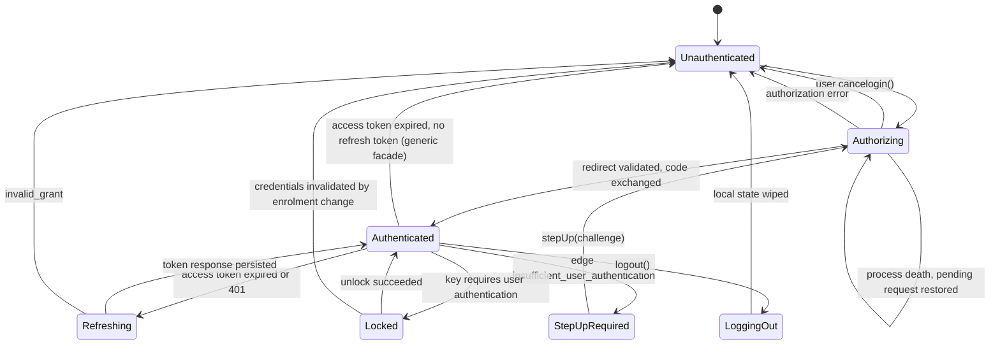

# Session state machine

Normative for every SDK. Android, iOS and Flutter implement *this* machine; they do not each
invent one. React Native would too, if built — it is last in the order agreed in #1 §1 and
conditional on demand, not yet a committed target, which is why it has no directory in #4's
layout and no required behaviour in `conformance/`. Where a platform cannot express a rule, the
deviation is recorded here rather than in platform code.

Grounded by issue #1. Conformance scenarios in [`conformance/`](conformance/) reference states
and transitions by the names used below.

## States

| State | Meaning |
|---|---|
| `Unauthenticated` | No usable grant. `login()` is the only meaningful call. |
| `Authorizing` | An authorization request is outstanding: the browser is open, or the app was killed while it was. |
| `Authenticated` | A refresh token is held and an access token is available or derivable. |
| `Refreshing` | A token request is in flight. Concurrent callers coalesce onto it; they do not each enter this state. |
| `StepUpRequired` | Edge refused a call with `insufficient_user_authentication`. The grant is valid; its authentication context is not sufficient. |
| `Locked` | Credentials are present but the key protecting them needs user authentication. Only reachable under `UnlockPolicy.OnAppUnlock`. |
| `LoggingOut` | RP-initiated logout is in flight. |

`Refreshing`, `StepUpRequired`, `Locked` and `LoggingOut` are sub-states of holding a grant:
the app is not signed out while in them, and UI should not treat them as such.

## Transitions



Every transition below names what is persisted at the moment it happens. Anything not named as
persisted is memory-only and is gone after process death by design.

### `Unauthenticated → Authorizing`

Triggered by `login(scopes)`. Before the browser opens, the SDK persists the **pending
authorization request**: PKCE `code_verifier`, `state`, `nonce`, requested scopes, target
`redirect_uri`, and the `acr_values` / `max_age` if this is a step-up. Encrypted through
`CredentialKeyProvider`.

Persisting before opening the browser, not after, is the whole point: the app can be killed
between the two.

**Through edge (`BackChannel.Edge`, #40)** the request is built by edge rather than by the
SDK: `login()` first calls `POST {edge}/native/start/{clientId}` with a DPoP proof signed for
that URL, and edge generates the PKCE pair and the `state`, pushes the request to `/par` with
`dpop_jkt` taken from the proof, and answers with a `request_uri`, the `state`, a sealed blob
holding the verifier, and the two auth endpoints later proofs are signed for. What the SDK
persists before the browser opens is then edge's `state`, the blob, the nonce, the scopes, the
redirect URI, the step-up parameters and those two endpoints — there is no `code_verifier` on
the device in this mode, and the browser opens on discovery's `authorization_endpoint` with
`client_id` and `request_uri` only. The persistence moment and its reason are unchanged.

### `Authorizing → Authenticated`

On redirect, in this order, all before any network call:

1. `state` matches the persisted value, compared in constant time
2. `iss` equals the issuer the provider's metadata announces (RFC 9207), by simple string
   comparison with no normalisation (section 2.4: a trailing slash or a case difference is a
   different issuer), if present; if absent, this is only a failure
   when discovery advertises `authorization_response_iss_parameter_supported` — a deployment
   that does not advertise it may legitimately omit `iss`
3. the response carries `code`

Then the code is exchanged. The token response is persisted **before** it is returned to the
caller, and the pending request is wiped only after the refresh token is durably stored.

Through edge, step 2 is not conditional: `/native/complete` requires `iss`, so a redirect
without one is refused whatever discovery advertises. The exchange is
`POST {edge}/native/complete/{clientId}` with `code`, `state`, `iss` and the blob, and a proof
whose `htu` is the `token_endpoint` from `/native/start` — auth's mutual-TLS listener, where
edge forwards the proof unchanged — not edge's own URL. Edge refuses a proof by any other key
than the one the flow started with before auth is called, so the code is not spent on it.

Persisted: refresh token (encrypted), raw ID token (encrypted, kept only for `logout()`'s
`id_token_hint`), DPoP key reference, issuer metadata cache.
Memory only: parsed ID token claims, both nonce caches.

### `Authorizing → Unauthenticated` — cancel

Two causes, and they must be distinguishable. The category is `Recoverable` for both, but the
app shows a different thing.

| Cause | Android | iOS |
|---|---|---|
| **User cancel** — user dismissed the browser | Auth Tab: the tab's result is `RESULT_CANCELED`. Custom Tabs fallback: tab closed with no redirect, app returned to foreground (a heuristic: Chrome's minimize button resumes the app too, which is why Auth Tab is preferred) | `ASWebAuthenticationSessionErrorCodeCanceledLogin` **while the app is not in the background** (`active` or `inactive`: the session's sheet makes the app `inactive` for as long as it is up, and the completion runs before it is active again) |
| **System cancel** — the OS tore the session down | activity destroyed while backgrounded, no redirect delivered; an Auth Tab result code the SDK does not know (for that cause alone the pending request is **wiped**, since the tab is gone and no redirect can follow) | the same error code **while the app is in the background**; in practice the OS killing the process, which no completion reports |

iOS reports both through one error code. Pairing it with app lifecycle state at the moment the
error arrives is the only way to separate them, and it is required, not optional: a system
cancel should be retried silently, a user cancel must not be.

The pending request is wiped on user cancel and **kept** on system cancel, so the flow can be
resumed. Kept for a resume, not reserved: nothing awaits it, so a new `login()` is not made to
wait out its ten minutes. It supersedes the leftover; a redirect its tab still delivers carries a
`state` that is not the new request's and is ignored like any other (below). The same holds for a
cold-start resume that only waits for its redirect: `login()` and `stepUp()` end that wait first
(as `logout()` does) and supersede the request.

#### A redirect that is not the awaited response (scenario 15)

While a request is pending and something awaits its redirect (a `login()` with the browser up, or
a resume after a cold start), only a redirect whose `state` equals the request's is the response.
The redirect URI is public (the app's manifest or associated domains name it), so any other app, an
old link or a stale tab can deliver a URL for it; such a redirect must not be able to end the login
it is not an answer to. A redirect for the configured redirect URI whose `state` is not the
pending request's, or that carries none while the request has one, is therefore **ignored**: no
token request, no error, the pending request and the `Authorizing` state kept, the wait continuing
until the genuine redirect, the user dismissing the browser, or the request's expiry. The expiry
bounds every wait on a redirect, a `login()` with its browser up as much as a resume: what is left of
the request's ten minutes after its creation, and when it runs out the wait ends with
`Recoverable(PendingRequestExpired)` and the slot is wiped (settling on `Authenticated` over a stored
grant, as every failed login does). The sheet or tab cannot outlive it: iOS cancels the wait, which
dismisses the sheet; an Android tab cannot be closed from the SDK and is left to the user, and its
redirect, arriving late, finds nothing to answer.

The SDK logs that it ignored a redirect, at most one line a second and counting the ones it leaves
out, without the URL or any value of it. The one exception is the redirect's `error` code, when it is
a plain token of at most 64 characters (never its description): a provider that answers a request
with an error and no `state` is ignored like any redirect without one, and the developer needs to
see why the login waits (`providers.md`). A URL that is not the configured redirect URI at all is
not a response either and is ignored by the facade before it reaches the flow.

Where this is decided, so that the same answer holds whichever way the redirect arrives:

- **At the platform's delivery point, when a login is waiting and its `state` is known.** Android:
  the exported redirect activity drops a non-matching intent before it is delivered, so it does not
  bring the app forward over the open tab, does not silence the foreground-return cancel detection
  and is not buffered. iOS: `handleRedirect(_:)` hands every URL for the redirect URI to the flow;
  there is no earlier point.
- **Where the pending request is read, which is the authority.** The flow compares each redirect's
  `state` with the request's, in constant time, before anything else. This is what covers a
  cold-started process, whose redirect arrives before anything expects it (Android: the redirect
  activity has no expectation yet; iOS: `handleRedirect` before the resume): the resume that reads
  the stored request skips every buffered redirect that does not match and validates the first that
  does, while it keeps waiting. The buffer is bounded (Android: the dispatcher's channel; iOS: eight
  URLs, the oldest dropped, except the first one the process was handed while nothing waited, which
  is the one that started it and which the others must not be able to push out).
- **A matching `state` completes or fails the login**, in the order of `Authorizing →
  Authenticated` above: a wrong or missing `iss` is `Configuration(IssuerMismatch)`, an `error`
  parameter is the provider's answer (`Reauthenticate` or `Configuration(AuthorizationRejected)`),
  and neither `code` nor `error` is `Configuration(MalformedAuthorizationResponse)`.

The one place a non-matching redirect still ends something is the browser surface itself ending
with it: iOS's `ASWebAuthenticationSession` completes the moment its page navigates to the callback
URL, and an Android Auth Tab returns the redirect as its result and closes. Such a redirect was
produced by a page inside that surface (a URL another app opens reaches the SDK through the
redirect activity or `handleRedirect(_:)`, not through the surface), and the surface that carried
it is gone: no dismissal can be observed any more and the genuine response cannot come from it, so
the wait cannot go on. The login ends as `Configuration(StateMismatch)` and the pending request is
wiped, like every failed browser leg. It is a failure the app can see, on purpose: a provider that
drops or rewrites `state` must not look like the user cancelling, and it is not a system cancel
either, which an app retries silently and which would loop on a provider that keeps answering for
another request.

`Configuration(StateMismatch)` is therefore produced in exactly that case (the awaited surface itself
ended on a foreign `state`), and by `AuthorizationResponseValidator.validate` for a redirect handed to
it directly, where the check stays as defence in depth. It is never the answer to a redirect that
merely arrived while the login waited.

The sign-out (`logout()`) follows the same rule for its own request: the `state` it sent is the one
that answers it, a redirect for the post-logout URI with another `state` or none is ignored and the
wait goes on, for the provider's page, the user closing it, or a surface that ended on a foreign
`state` (reported as the browser failing, so "not acknowledged" like every failure of that leg). The
sign-out has no request to expire; the user's dismissal ends it.

iOS, a caller cancelled mid-browser (a SwiftUI `.task` torn down by navigation): the SDK's
cancellation handler dismisses the `ASWebAuthenticationSession`, so nothing can redirect
afterwards, and the pending request is **wiped** as for a user cancel. Android keeps it, because
a Custom Tab outlives its caller and may still redirect; that difference is the platform's.

### `Authorizing → Authorizing` — process death

On startup, if a pending authorization request exists it is restored and the SDK re-enters
`Authorizing` rather than reporting `Unauthenticated`. A redirect delivered to a cold-started
process is then validated against the restored `state` and completes normally.

A pending request older than **10 minutes** is discarded and the SDK settles in
`Unauthenticated`; authorization codes do not outlive that anyway.

A **stored refresh grant outranks a pending request** on restore, and is read first: with no
pending request the SDK restores `Authenticated` rather than reporting a returning user as
signed out, and with one beside it the request is the residue of a login killed between
persisting the token and clearing the slot — its code was already redeemed, so the redirect it
waits for can no longer be spent. The request is discarded and the SDK restores
`Authenticated`. Asked without the storage key (`hasGrant`), so a cold start does not become an
unlock prompt under `OnAppUnlock`.

A store that cannot be read yet (iOS: the device was never unlocked since boot, and the Keychain
answers `errSecInteractionNotAllowed`; Android: the storage key is locked, or the Keystore failed
transiently) has not said there is nothing in it. With no grant to decide the state the restore
then publishes `Locked`, never `Unauthenticated`, fails the operation that asked with the
`Recoverable` storage error (`UnlockRequired` on iOS), does not discard the slot, and is **not**
remembered: the next call, once the app has asked the user to unlock, reads again. The grant is
read before the pending request for this reason too: an unreadable pending slot must not decide
what a returning user sees. When a later read finds the request, the cold-start resume is started
then, not only at creation (Android). A collector of the state is not handed the error. With a
grant the restore also **clears the pending slot on every cold start**, unread (it is residue,
above); a slot that cannot be cleared yet fails the restore the same way and is retried.

The cost is a re-authorization started over a live session — a step-up, an account switch — and
then killed mid-browser: it resolves in favour of the session that already exists rather than
resuming. Nothing is lost that the next 401 does not ask for again, and the two cases are
otherwise indistinguishable from what is on disk.

This is the `flutter_appauth` failure recorded in `mobile-demo`'s `pubspec.yaml`. It is not an
edge case on Android.

### `Authenticated → Refreshing → Authenticated`

Entered when the access token is expired, within its refresh skew, or a call returned 401 that
is *not* a step-up, *not* a nonce demand, and *not* `invalid_dpop_proof` (below). A refresh
cannot repair an invalid proof — it reuses the same DPoP key — so that case never reaches this
state.

#### The refresh skew

```text
skew = min(30 s, expires_in / 10)
```

A token is treated as due for refresh once `expires_in − skew` has elapsed since it was issued.

Proportional rather than a flat constant, because `expires_in` is per-client configuration
(`OAuthClientRecord.accessTokenTtl`, 3600 s in the bootstrap default) and nothing stops a
deployment from issuing 20-second tokens. A flat 30 s against a 20 s token marks every token
stale at the moment it is issued, and the session then refreshes before every single call —
which under bearer [redacted] is a rotation per call. The `/ 10` term is what makes that
unrepresentable: the skew can never exceed a tenth of the lifetime, so proactive refresh can
never add more than one token request per ten uses, at any TTL. The 30 s cap is what stops a
long-lived token from being refreshed six minutes early for no benefit.

`expires_in` absent or zero is *unknown*, not *expired*: no proactive refresh happens, and the
session waits for the 401. A response that does not say when its token dies is not saying it is
already dead.

Elapsed time here is measured on a **monotonic** clock, not the wall clock and not the
skew-corrected clock the DPoP `iat` uses. Those two answer a different question — what time the
server thinks it is — whereas this one is how long ago the response arrived, and a user or an
NTP step moving the wall clock mid-session must not make a live token look expired or an
expired one look live.

**Exactly one** token request may be in flight per session. Concurrent callers await the
winner's result; they do not queue further requests. In bearer mode this is a correctness
requirement rather than an optimisation — concurrent rotations are replays, and a replay
revokes the family.

Every refresh carries an `Idempotency-Key`. The key is derived from the refresh token
generation being consumed, so a retry after a dropped response reuses it and resolves to the
same rotation.

The `Idempotency-Key` is the Versola facade's: auth honours it, and no standard requires a
provider to. The generic facade (`oauth-sdk-api.md` section 8) sends none, persists the same
`pending` slot, and on a replay the provider decides; a provider that already rotated answers
`invalid_grant`, which is `Reauthenticate`.

Persistence, in order:

1. the outgoing generation is copied into a `pending` slot before the request is sent
2. the response is persisted before it is returned to any caller: the rotated refresh token
   first, **before the ID token the response carries is validated**
3. the `pending` slot is cleared after the new value is durably stored, and before the ID token is
   validated, since it named the generation that was just consumed

A process killed between 1 and 3 recovers by replaying with the same idempotency key on next
start; the server resolves which generation is live.

The order of 2 and the validation is the point: the provider rotates the moment it answers, so
the old refresh token is already spent and the new one is the only credential left. An ID token
that cannot be judged or fails is rejected **on its own**; the rotation is not discarded with it,
because the next refresh would then spend a dead token, get `invalid_grant` and wipe a healthy
session. What the app sees is the validation's own outcome, and the grant is intact either way:

| Validation outcome | Rotated refresh token | Access token, claims, stored ID token | Error | State |
|---|---|---|---|---|
| passes | stored | the new ones | none | `Authenticated` |
| fails (`IdTokenRejected`: signature, `iss`, `aud`, `sub` changed, ...) | stored | not kept: the previous claims and stored ID token stand | `Configuration(IdTokenRejected)` | `Authenticated` |
| the key set cannot be fetched, but one past its lifetime (at most a week) holds the key | stored | the new ones, judged against that set (`retry-policy.md`, "A stale key set for a refresh") | none | `Authenticated` |
| cannot run (the key set cannot be fetched and no usable stale one is held, or it lacks the `kid`: `Network`, `Server`, `UnlockRequired`) | stored | not kept: the previous access token is whatever the cache held (expired, which is why a refresh ran), nothing new | the `Recoverable` cause | `Authenticated` (`Locked` for `UnlockRequired`) |

The stored ID token (what `id_token_hint` and the claims of a cold start are read from) is
replaced only by one that **passed**, never by an unchecked one. A refresh response without
`id_token` leaves the stored one in place (OpenID Connect Core 12.2 permits the omission), and a
validated one is stored whether or not the refresh token rotated. Nothing on the refresh path
deletes a stored ID token; only a login that replaces the grant, or a wipe, does.

Under DPoP the server renews the refresh token in place (`BoundRenewal`) and the stored value
does not change — the response echoes the same `refresh_token`, which is stored again as it
was — so steps 1 and 3 are inert. The machinery exists for bearer mode.

Through edge the request is `POST {edge}/native/token/{clientId}`, carrying the same
`Idempotency-Key` (edge forwards it) and a proof signed for the remembered `token_endpoint`.
A `use_dpop_nonce` in the relayed answer is auth's nonce and is cached under auth's origin,
not edge's: the next proof for that `htu` carries it, and edge's own cache is untouched.

### `Authenticated → Unauthenticated` — no refresh token

Generic facade only. A provider that issued no `refresh_token` leaves a session that lives as
long as its access token. When the token is observed expired (by the refresh skew or a 401),
there is nothing to spend: the SDK wipes the ID token and claims, publishes `Unauthenticated`,
and the operation fails with `Reauthenticate(SessionExpired)`. No token request is made and the
browser is not opened. Scenario 31.

A login that issues no refresh token over a stored grant removes that grant, but keeps the DPoP
key: the login's own exchange was signed with it, so the new access token is bound to it, and the
key is destroyed only by the teardown of a logout or of a rejected grant.

### `Refreshing → Unauthenticated`

Only on `invalid_grant`. Network failures, `use_dpop_nonce`, 429 and 5xx leave the state at
`Authenticated` and are retried under the SDK's own policy, which honours `Retry-After`
(`retry-policy.md`).

Everything credential-shaped is wiped: refresh token, pending slot, nonce caches. The DPoP key
follows the logout rule (below).

A refresh asked for while **no grant is stored** is not this transition. The provider said
nothing, so there is no `invalid_grant`: the call fails with `Reauthenticate(GrantRejected)`, no
token request is made, `Refreshing` is never entered, and **nothing is wiped**. That teardown
would clear the pending authorization of a sign-in in progress (an app that asks for a token
before it has let the cold-start resume finish) and destroy the DPoP key that sign-in's
`dpop_jkt` committed to, so the code exchange that followed would sign with a key matching
nothing. The state stays `Authorizing` or `Unauthenticated` where it was; a session that believed
it held a grant (the item was removed from under the app) settles `Unauthenticated`, its
in-memory access token and claims dropped, the key and the pending request untouched. A real
`invalid_grant` still wipes.

### `Authenticated → Authenticated` — `invalid_dpop_proof`, then `Authenticated → Unauthenticated`

A 401 with `invalid_dpop_proof` (token endpoint, UserInfo or edge — see
[`errors.md`](errors.md)) is retried **once**, in place, with a freshly minted proof for the
same access token: the usual cause is clock skew the SDK can now correct from the response's
`Date` header. This is handled internally and never surfaced to the app, the same treatment as
`use_dpop_nonce`.

The offset is learned from the `Date` header of **every** response from a server the proofs are
for, a success as much as a refusal, so the retry's `iat` is already corrected when it is minted
and a device with a wrong clock usually pays no refusal at all after its first request.
One offset per client, shared by every origin, **the last response wins** (a server whose own clock
is wrong moves it until the next one that is right); in memory only (see the persistence summary);
an absent or unparseable `Date` leaves what was learned in place. Two things are not learned from: a `Date` more
than 30 days from the device clock (a device that far off could not complete a TLS handshake against
most certificates, so the value is a stale cache or a broken intermediary), and a response with an
`Age` header other than `0` (it was generated earlier and handed back by a cache or proxy, so its
`Date` is when the origin made it, RFC 9111 section 5.1, not now; on iOS also one the URL cache
produced). UserInfo follows the same rule
as the token endpoint and the authenticated client: `invalid_dpop_proof` is retried **once**, in
place, with the same access token and a fresh proof, spending no renewal and so rotating no
refresh token, and a second one is `Reauthenticate(CredentialsInvalidated)`.

A second failure means the key no longer matches the grant, not a timing problem. Nothing
retries it again: the SDK wipes credential state exactly as `Refreshing → Unauthenticated` does
and surfaces `Reauthenticate`.

### `Authenticated → StepUpRequired → Authorizing`

Edge answers a call it will not serve with `401` and

```http
WWW-Authenticate: Bearer error="insufficient_user_authentication", acr_values="…", max_age="…"
```

Note the scheme: edge emits **`Bearer`** on this challenge even for DPoP-bound callers, and
`DPoP` on `invalid_dpop_proof` and `use_dpop_nonce`. Parse on the `error` value, not the
scheme.

This is not a refresh condition. A client that refreshes here loops forever against a token
that can never satisfy the ACR. The SDK surfaces `StepUp(acrValues, maxAge)`; `stepUp()`
re-enters `Authorizing` carrying those parameters, and the originating call is resumed once
`Authenticated` is reached again.

The originating request is held in memory only. A process death during step-up loses it, and
the app is expected to re-issue the call.

### `Authenticated → Locked → Authenticated`

Reachable only under `UnlockPolicy.OnAppUnlock`. Under the default, `UnlockPolicy.None`, no
transition into `Locked` exists.

**The refresh token is unwrapped for the duration of one token request and no longer.** It is
read inside the request that consumes it, used to build the request body, and the plaintext
buffer is zeroed once the body is formed. No layer caches the unwrapped value between requests:
holding it for a session would widen the exposure window from one network call to the lifetime
of the process, which leaves encrypting it at rest doing very little.

A policy gates the *storage* key and nothing else. The DPoP key is never gated under any
policy — it signs a proof on every request, so gating it is a prompt per request under another
name, and Android fails biometric authentication outside the foreground, which would end
background refresh outright.

Gating is a **time-bound** authorization of the key, not an auth-per-use binding:

| Platform | Mechanism |
|---|---|
| Android | `setUserAuthenticationParameters(300, AUTH_BIOMETRIC_STRONG or AUTH_DEVICE_CREDENTIAL)`, or `setUserAuthenticationValidityDurationSeconds(300)` below API 30 |
| iOS | the device unlock itself: the items are `WhenUnlockedThisDeviceOnly` (see the iOS deviation below) |

300 seconds is iOS's own ceiling for that window. Android permits a longer one; matching the
stricter platform keeps this one machine rather than two. Any matching OS authentication inside
the window satisfies the key — including the device unlock the user performed to open the app —
so a typical session raises no prompt of the SDK's own.

Once the window has elapsed, unwrapping fails: the SDK enters `Locked` and surfaces
`Recoverable(UnlockRequired)`. The app presents the prompt and retries. The SDK does not present
it, because it holds no `Activity` and a prompt is a UI decision. The access token already in
memory stays usable until it expires, so `Locked` blocks refresh rather than every call.

Because nothing is cached, this can occur mid-session rather than once per launch. It is bounded
by refresh cadence — at most one prompt per access-token lifetime, never one per API call — and
that bound is what is paid for never holding the credential in memory. Neither platform offers
both at once.

**iOS deviation.** The iOS SDK does not gate the storage on `LAContext` user presence with a
300-second reuse window. `UnlockPolicy.OnAppUnlock` puts the credential items in the
`kSecAttrAccessibleWhenUnlockedThisDeviceOnly` class instead (the default, `None`, is
`AfterFirstUnlockThisDeviceOnly`): they are readable while the device is unlocked and refused
with `errSecInteractionNotAllowed` while it is locked, which is `Locked` and
`Recoverable(UnlockRequired)` here, with the grant intact. The device unlock is the
authentication, so a session raises no prompt of the SDK's own, and a refresh from a background
task on a locked device waits for the next unlock.

The window design is not implemented because it needs what this specification does not define
and a test tier the repository does not have. The SDK cannot present the prompt, so the app would
have to hand it the `LAContext` that satisfied the item's access control, which is a new public
parameter of `UnlockPolicy`; and its behaviour depends on biometric enrolment, which only a
physical phone can exercise. Two rows of this specification therefore do not apply on iOS: the
300-second window, and `Locked → Unauthenticated` on a biometric enrolment change (a
`WhenUnlocked` item survives it). A deployment that needs a stronger gate than the device lock
needs a new `UnlockPolicy` case with its own definition, not a reading of this one.

The prompt must be bound to the crypto operation (`BiometricPrompt.CryptoObject`, `LAContext`
reuse) rather than gating on a boolean returned by a biometric API. A boolean gates nothing: a
patched binary returns `true`. `mobile-demo`'s `device_lock.dart` is the worked example of the
wrong version.

**There is no per-call tier.** An earlier revision of this document specified `OnEveryCall`,
which gated the DPoP key as well. It is removed rather than left unimplemented, because no
implementation of it is usable:

- Android's guidance scopes auth-per-use keys to "high-value transactions, such as making a
  large payment" — per sensitive operation, not per request.
- NIST SP 800-63B drives reauthentication off inactivity and overall session age (AAL2: 12 h /
  30 min in rev 3, 24 h / 1 h in rev 4), never off a request count.
- PSD2 requires SCA per *payment initiation*, and the EBA extended account-information
  reauthentication from 90 days to 180. Even regulated banking does not reprompt per call.

What that tier was reaching for — authenticate *this* operation — already exists one layer up as
`StepUpRequired`, where the server names the ACR it requires. That is the correct layer: a
client-side key configuration cannot tell a balance check from a transfer, and the server can.

### `Locked → Unauthenticated`

Biometric enrolment changes invalidate the storage key, and the wrapped refresh token becomes
undecryptable. This is indistinguishable from tampering and is treated as sign-out:
`Reauthenticate`, wipe, no error dialog beyond that.

### `Authenticated → LoggingOut → Unauthenticated`

`logout()` revokes the refresh token at `/revoke` (through `/native/revoke` under
`BackChannel.Edge`, with a proof signed for the remembered `revocation_endpoint`), opens auth's
`/logout` with `id_token_hint`, `client_id`, `post_logout_redirect_uri` and a `state`, then wipes local
state. Revocation comes first: a user who dismisses the signed-out page has still had the grant
killed at the server. The `id_token_hint` is the last ID token held, which every refresh
renews; auth silently ignores an expired hint and then has no session to end, so a session
that has not refreshed within one access-token lifetime ends locally and may survive at auth.
`logout()` reports whether auth acknowledged — the redirect came back carrying the `state`
sent — and the app decides whether that matters.

Local state is wiped **even if the browser leg fails or is dismissed**. Reaching
`Unauthenticated` locally is unconditional; only the server-side session teardown is
best-effort.

The DPoP key is **destroyed** on logout. It is cheap to regenerate and its purpose is binding
one grant to one device-installation; reusing it across users on a shared device defeats that.

## Persistence summary

| Item | Storage | Survives process death | Survives logout |
|---|---|---|---|
| Refresh token | Encrypted, `CredentialKeyProvider` | yes | no |
| Refresh token, unwrapped | Memory, one token request, zeroed after | no | no |
| Pending refresh generation | Encrypted | yes | no |
| Pending authorization request | Encrypted | yes, ≤10 min | no |
| Sealed blob from `/native/start` (edge mode) | Encrypted, inside the pending request | yes, ≤10 min | no |
| `token_endpoint` and `revocation_endpoint` from `/native/start` (edge mode) | Disk, unencrypted | yes | yes |
| Access token | Memory | no | no |
| ID token (raw, for `id_token_hint`) | Encrypted, `CredentialKeyProvider` | yes | no |
| ID token claims (parsed) | Memory | no | no |
| DPoP private key | Hardware keystore, non-exportable | yes | no (destroyed) |
| DPoP nonce, per origin | Memory | no | no |
| Clock skew offset | Memory | no | no |
| Discovery metadata, with the lifetime it was fetched with | Disk, unencrypted | yes, until the lifetime ends | yes |
| JWK Set (generic facade), with the lifetime it was fetched with | Disk, unencrypted | yes, until the lifetime ends (a week more for a refresh's ID token only) | yes |

**Uninstall.** Android's credentials are files in the app's own data and go with the app. The
iOS Keychain outlives it: a reinstall on the same device would otherwise open signed in as the
previous install's user. The iOS SDK therefore writes a marker file beside its caches
(Application Support, excluded from backup, so it goes with the app and is not restored by an
iCloud backup) and, on the first launch that finds neither a marker nor any cache, deletes every
Keychain item of the client (refresh token, ID token, rotation slot, pending request, DPoP key)
before any of them is read. A launch that finds caches but no marker is an upgrade from a version
that wrote none, and keeps its session. If the delete fails because the device is locked, the
marker is not written and the operation that triggered it fails with `Recoverable(UnlockRequired)`;
the next one tries again.

Where this does not act, by decision: **an app extension** (share, notification service, widget)
has a container of its own that is empty on its first run, but it was not just installed and the
Keychain items may be the host app's, shared through a keychain access group, so the guard is inert
in an extension process (bundle path ending `.appex` or an `NSExtension` Info.plist key) and the host
app's own first launch decides. **A configured Keychain access group** is shared on purpose and
outlives any one app of the group, so the guard is not built for a client that configures one (the
generic facade configures none). **An App Clip** is a separate app with its own container and its own
default access group, so it is treated as an app: its container is evicted while its Keychain
items are not. In every case the delete is scoped to the process's own default access group,
learned from a throwaway item, never to the other groups the process is entitled to; if that group
cannot be learned nothing is deleted.

Discovery metadata is not credential material and is cached across logout deliberately: a
re-login should not need a round trip to `/.well-known/openid-configuration`. It is fetched again
when its lifetime has ended (the provider's `Cache-Control: max-age` or `Expires`, held between 5
minutes and 24 hours, 24 hours when it says nothing), in memory and on disk; if the provider cannot
be reached then, the old document is served once more and the next try waits a minute (it is not
what anything is verified against, and a `logout()` offline must still finish). The JWK Set is cached the same way but fails closed: an expired set that cannot be
refetched is not served, because a withdrawn signing key is what it would still vouch for (the one
exception is a refresh's ID token, up to a week past expiry: `retry-policy.md`, "A stale key set for a refresh"). The two native
endpoints are kept for the same reason: a refresh in a later process signs for them and has no
`/native/start` of its own to learn them from. Without the file the SDK falls back to
discovery's `mtls_endpoint_aliases`, then to the plain endpoints — inferences, where the file
is edge's own answer.

**Record binding (Android).** The key provider wraps each encrypted item with the name of its
slot in front of the secret (`credentials/refreshToken`, `credentials/rawIdToken`,
`credentials/pendingRotation`, `pending-authorization`). AES-GCM authenticates the whole
plaintext, so a valid blob moved from one slot to another does not open there and is read as
the tampered ciphertext it is (`errors.md`: a sign-out). Items written by 0.1.0 carry no name and
are read as they are, so an upgrade keeps the user signed in; each credential is rewritten bound
as soon as it has been read (best effort: a failed rewrite leaves the readable legacy item and is
retried at the next read), and the pending request, which lives minutes, by the next login. Until
then a legacy item opens in any slot. The
format is one-way: an SDK that predates the binding reads a bound item as a garbled token, so
rolling an app back to it signs the user out. The binding does not stop a stale copy of the
same slot being put back; that needs a counter nothing here keeps.

**One process.** Everything above, and everything the coordinator coordinates (the
single-flight refresh, the authorize lock, the redirect hand-off), is per process. The SDK
assumes it runs in the app's main process. An app that gives components their own
`android:process` and uses the SDK there gets a second coordinator over the same files: two
refreshes can race on one rotating refresh token (the loser's replay is `invalid_grant` and may
revoke the token family), and DataStore does not support two processes over one file. This is
not detected or coordinated; keep SDK calls in one process.

## Observability

Each SDK exposes the current state as a stream — `Flow<SessionState>` on Android,
`AsyncStream<SessionState>` on iOS, `Stream<SessionState>` in Dart. The state values are the
seven above and no others; platform-specific states are not permitted.
