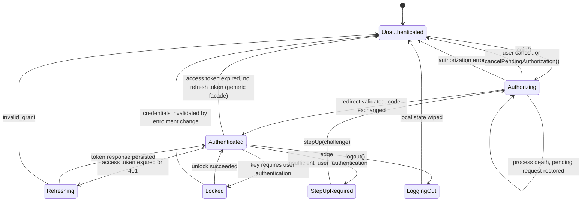

# Session state machine

Normative for every SDK. Android, iOS and Flutter implement *this* machine; they do not each
invent one. React Native would too, if built — it is last in the order agreed in #1 §1 and
conditional on demand, not yet a committed target, which is why it has no directory in #4's
layout and no required behaviour in `conformance/`. Where a platform cannot express a rule, the
deviation is recorded here rather than in platform code.

Grounded by issue #1. Conformance scenarios in [`conformance/`](conformance/) reference states
and transitions by the names used below.

## States

| State | Meaning |
|---|---|
| `Unauthenticated` | No usable grant. `login()` is the only meaningful call. |
| `Authorizing` | An authorization request is outstanding: the browser is open, or the app was killed while it was. |
| `Authenticated` | A refresh token is held and an access token is available or derivable. |
| `Refreshing` | A token request is in flight. Concurrent callers coalesce onto it; they do not each enter this state. |
| `StepUpRequired` | Edge refused a call with `insufficient_user_authentication`. The grant is valid; its authentication context is not sufficient. |
| `Locked` | Credentials are present but the key protecting them needs user authentication. Only reachable under `UnlockPolicy.OnAppUnlock`. |
| `LoggingOut` | RP-initiated logout is in flight. |

`Refreshing`, `StepUpRequired`, `Locked` and `LoggingOut` are sub-states of holding a grant:
the app is not signed out while in them, and UI should not treat them as such.

## Transitions



Every transition below names what is persisted at the moment it happens. Anything not named as
persisted is memory-only and is gone after process death by design.

### `Unauthenticated → Authorizing`

Triggered by `login(scopes)`. Before the browser opens, the SDK persists the **pending
authorization request**: PKCE `code_verifier`, `state`, `nonce`, requested scopes, target
`redirect_uri`, and the `acr_values` / `max_age` if this is a step-up. Encrypted through
`CredentialKeyProvider`.

Persisting before opening the browser, not after, is the whole point: the app can be killed
between the two.

**Through edge (`BackChannel.Edge`, #40)** the request is built by edge rather than by the
SDK: `login()` first calls `POST {edge}/native/start/{clientId}` with a DPoP proof signed for
that URL, and edge generates the PKCE pair and the `state`, pushes the request to `/par` with
`dpop_jkt` taken from the proof, and answers with a `request_uri`, the `state`, a sealed blob
holding the verifier, and the two auth endpoints later proofs are signed for. What the SDK
persists before the browser opens is then edge's `state`, the blob, the nonce, the scopes, the
redirect URI, the step-up parameters and those two endpoints — there is no `code_verifier` on
the device in this mode, and the browser opens on discovery's `authorization_endpoint` with
`client_id` and `request_uri` only. The persistence moment and its reason are unchanged.

### `Authorizing → Authenticated`

On redirect, in this order, all before any network call:

1. `state` matches the persisted value, compared in constant time
2. `iss` equals the issuer the provider's metadata announces (RFC 9207), by simple string
   comparison with no normalisation (section 2.4: a trailing slash or a case difference is a
   different issuer), if present; if absent, this is only a failure
   when discovery advertises `authorization_response_iss_parameter_supported` — a deployment
   that does not advertise it may legitimately omit `iss`
3. the response carries `code`

Then the code is exchanged. The token response is persisted **before** it is returned to the
caller, and the pending request is wiped only after the refresh token is durably stored.

Through edge, step 2 is not conditional: `/native/complete` requires `iss`, so a redirect
without one is refused whatever discovery advertises. The exchange is
`POST {edge}/native/complete/{clientId}` with `code`, `state`, `iss` and the blob, and a proof
whose `htu` is the `token_endpoint` from `/native/start` — auth's mutual-TLS listener, where
edge forwards the proof unchanged — not edge's own URL. Edge refuses a proof by any other key
than the one the flow started with before auth is called, so the code is not spent on it.

Persisted: refresh token (encrypted), raw ID token (encrypted, kept only for `logout()`'s
`id_token_hint`), DPoP key reference, issuer metadata cache.
Memory only: parsed ID token claims, both nonce caches.

### `Authorizing → Unauthenticated` — cancel

Two causes, and they must be distinguishable. The category is `Recoverable` for both, but the
app shows a different thing.

| Cause | Android | iOS |
|---|---|---|
| **User cancel** — user dismissed the browser | Auth Tab: the tab's result is `RESULT_CANCELED`. Custom Tabs fallback: tab closed with no redirect, app returned to foreground (a heuristic: Chrome's minimize button resumes the app too, which is why Auth Tab is preferred) | `ASWebAuthenticationSessionErrorCodeCanceledLogin` **while the app is not in the background** (`active` or `inactive`: the session's sheet makes the app `inactive` for as long as it is up, and the completion runs before it is active again) |
| **System cancel** — the OS tore the session down | activity destroyed while backgrounded, no redirect delivered; an Auth Tab result code the SDK does not know (for that cause alone the pending request is **wiped**, since the tab is gone and no redirect can follow) | the same error code **while the app is in the background**; in practice the OS killing the process, which no completion reports |

iOS reports both through one error code. Pairing it with app lifecycle state at the moment the
error arrives is the only way to separate them, and it is required, not optional: a system
cancel should be retried silently, a user cancel must not be.

The pending request is wiped on user cancel and **kept** on system cancel, so the flow can be
resumed.

**App cancel.** A pending request whose browser is gone — the app was killed while it was open and
the user came back to the app itself, not through the redirect — is awaited by the cold-start resume
and so is *in flight* (`oauth-sdk-api.md` section 5): `login()` is refused, and nothing observes the
browser from a process that was not running when it opened, for the rest of its ten minutes. The app
says so with `cancelPendingAuthorization()`: a `login()` or resume that is waiting for the browser
ends with `Recoverable(UserCancelled)`, the pending request is wiped and the state settles as for a
user cancel (`Authenticated` over a stored grant, otherwise `Unauthenticated`); a tab that is still
open may yet redirect, and that redirect is discarded rather than failing the next login as a state
mismatch. With nothing pending it does nothing. Android has it first (`OAuthClient`); iOS and
Flutter add the same call with the same semantics.

A pending request that nobody awaits (a cancelled caller kept it for a resume the app never asked
for, a system cancel did, or a restore found it and nothing started) is not in flight: it is kept
for a resume, not reserved, and a new `login()` supersedes it, remembering its `state` so a
redirect its tab still delivers is stepped over.

iOS, a caller cancelled mid-browser (a SwiftUI `.task` torn down by navigation): the SDK's
cancellation handler dismisses the `ASWebAuthenticationSession`, so nothing can redirect
afterwards, and the pending request is **wiped** as for a user cancel. Android keeps it, because
a Custom Tab outlives its caller and may still redirect; that difference is the platform's.

### `Authorizing → Authorizing` — process death

On startup, if a pending authorization request exists it is restored and the SDK re-enters
`Authorizing` rather than reporting `Unauthenticated`. A redirect delivered to a cold-started
process is then validated against the restored `state` and completes normally.

A pending request older than **10 minutes** is discarded and the SDK settles in
`Unauthenticated`; authorization codes do not outlive that anyway.

A **stored refresh grant outranks a pending request** on restore, and is read first: with no
pending request the SDK restores `Authenticated` rather than reporting a returning user as
signed out, and with one beside it the request is the residue of a login killed between
persisting the token and clearing the slot — its code was already redeemed, so the redirect it
waits for can no longer be spent. The request is discarded and the SDK restores
`Authenticated`. Asked without the storage key (`hasGrant`), so a cold start does not become an
unlock prompt under `OnAppUnlock`.

The cost is a re-authorization started over a live session — a step-up, an account switch — and
then killed mid-browser: it resolves in favour of the session that already exists rather than
resuming. Nothing is lost that the next 401 does not ask for again, and the two cases are
otherwise indistinguishable from what is on disk.

This is the `flutter_appauth` failure recorded in `mobile-demo`'s `pubspec.yaml`. It is not an
edge case on Android.

### `Authenticated → Refreshing → Authenticated`

Entered when the access token is expired, within its refresh skew, or a call returned 401 that
is *not* a step-up, *not* a nonce demand, and *not* `invalid_dpop_proof` (below). A refresh
cannot repair an invalid proof — it reuses the same DPoP key — so that case never reaches this
state.

#### The refresh skew

```text
skew = min(30 s, expires_in / 10)
```

A token is treated as due for refresh once `expires_in − skew` has elapsed since it was issued.

Proportional rather than a flat constant, because `expires_in` is per-client configuration
(`OAuthClientRecord.accessTokenTtl`, 3600 s in the bootstrap default) and nothing stops a
deployment from issuing 20-second tokens. A flat 30 s against a 20 s token marks every token
stale at the moment it is issued, and the session then refreshes before every single call —
which under bearer [redacted] is a rotation per call. The `/ 10` term is what makes that
unrepresentable: the skew can never exceed a tenth of the lifetime, so proactive refresh can
never add more than one token request per ten uses, at any TTL. The 30 s cap is what stops a
long-lived token from being refreshed six minutes early for no benefit.

`expires_in` absent or zero is *unknown*, not *expired*: no proactive refresh happens, and the
session waits for the 401. A response that does not say when its token dies is not saying it is
already dead.

Elapsed time here is measured on a **monotonic** clock, not the wall clock and not the
skew-corrected clock the DPoP `iat` uses. Those two answer a different question — what time the
server thinks it is — whereas this one is how long ago the response arrived, and a user or an
NTP step moving the wall clock mid-session must not make a live token look expired or an
expired one look live.

**Exactly one** token request may be in flight per session. Concurrent callers await the
winner's result; they do not queue further requests. In bearer mode this is a correctness
requirement rather than an optimisation — concurrent rotations are replays, and a replay
revokes the family.

Every refresh carries an `Idempotency-Key`. The key is derived from the refresh token
generation being consumed, so a retry after a dropped response reuses it and resolves to the
same rotation.

The `Idempotency-Key` is the Versola facade's: auth honours it, and no standard requires a
provider to. The generic facade (`oauth-sdk-api.md` section 8) sends none, persists the same
`pending` slot, and on a replay the provider decides; a provider that already rotated answers
`invalid_grant`, which is `Reauthenticate`.

Persistence, in order:

1. the outgoing generation is copied into a `pending` slot before the request is sent
2. the response is persisted before it is returned to any caller
3. the `pending` slot is cleared after the new value is durably stored, in the same write as 2
   where the store can make one (a kill between two writes would leave the new token beside the
   previous generation's idempotency key)

A process killed between 1 and 3 recovers by replaying with the same idempotency key on next
start; the server resolves which generation is live.

**An ID token on a refresh response** (the generic facade, and the Versola facade once it validates
them) is judged *after* step 2, never before: by then the provider has rotated, so the new
refresh token is the only live one and dropping it would turn a JWKS fetch failure, an unknown
`kid` or a changed `sub` into `invalid_grant` on the next refresh and a wipe. What the ID token
vouches for waits for its validation: the raw ID token (stored only once validated, so it is
never replayed as `id_token_hint` unchecked), the claims and the access token of that response
are kept only if it passes. A rejection leaves the session `Authenticated` on the rotated
token and fails the call as `Configuration(IdTokenRejected)`; a key set that cannot be reached
fails it as `Recoverable`, and the next refresh simply runs again. A caller cancelled during
the validation has already kept the rotated token.

Under DPoP the server renews the refresh token in place (`BoundRenewal`) and the stored value
does not change — the response echoes the same `refresh_token`, which is stored again as it
was — so steps 1 and 3 are inert. The machinery exists for bearer mode.

Through edge the request is `POST {edge}/native/token/{clientId}`, carrying the same
`Idempotency-Key` (edge forwards it) and a proof signed for the remembered `token_endpoint`.
A `use_dpop_nonce` in the relayed answer is auth's nonce and is cached under auth's origin,
not edge's: the next proof for that `htu` carries it, and edge's own cache is untouched.

### `Authenticated → Unauthenticated` — no refresh token

Generic facade only. A provider that issued no `refresh_token` leaves a session that lives as
long as its access token. When the token is observed expired (by the refresh skew or a 401),
there is nothing to spend: the SDK wipes the ID token and claims, publishes `Unauthenticated`,
and the operation fails with `Reauthenticate(SessionExpired)`. No token request is made and the
browser is not opened. Scenario 31.

### `Refreshing → Unauthenticated`

Only on `invalid_grant`. Network failures, `use_dpop_nonce`, 429 and 5xx leave the state at
`Authenticated` and are retried under the SDK's own policy, which honours `Retry-After`
(`retry-policy.md`).

Everything credential-shaped is wiped: refresh token, pending slot, nonce caches. The DPoP key
follows the logout rule (below).

A refresh asked for while **no grant is stored** is not this transition. The provider said
nothing, so there is no `invalid_grant`: the call fails with `Reauthenticate(GrantRejected)`, no
token request is made, `Refreshing` is never entered, and **nothing is wiped**. That teardown
would clear the pending authorization of a sign-in in progress (an app that asks for a token
before it has let the cold-start resume finish) and destroy the DPoP key that sign-in's
`dpop_jkt` committed to, so the code exchange that followed would sign with a key matching
nothing. The state stays `Authorizing` or `Unauthenticated` where it was; a session that believed
it held a grant (the item was removed from under the app) settles `Unauthenticated`, its
in-memory access token and claims dropped, the key and the pending request untouched. A real
`invalid_grant` still wipes.

### `Authenticated → Authenticated` — `invalid_dpop_proof`, then `Authenticated → Unauthenticated`

A 401 with `invalid_dpop_proof` (token endpoint, UserInfo or edge — see
[`errors.md`](errors.md)) is retried **once**, in place, with a freshly minted proof for the
same access token: the usual cause is clock skew the SDK can now correct from the response's
`Date` header. This is handled internally and never surfaced to the app, the same treatment as
`use_dpop_nonce`.

The offset is learned from the `Date` header of **every** response from a server the proofs are
for, a success as much as a refusal, so the retry's `iat` is already corrected when it is minted.
One offset per client, shared by every origin, the last response wins; in memory only; an absent or
unparseable `Date` leaves what was learned in place. Two things are not learned from: a `Date` more
than 30 days from the device clock (a device that far off could not complete a TLS handshake against
most certificates, so the value is a stale cache or a broken intermediary), and a response with an
`Age` header other than `0` (it was generated earlier and handed back by a cache or proxy, so its
`Date` is when the origin made it, RFC 9111 section 5.1, not now). UserInfo follows the same rule
as the token endpoint and the authenticated client: `invalid_dpop_proof` is retried **once**, in
place, with the same access token and a fresh proof, spending no renewal and so rotating no
refresh token, and a second one is `Reauthenticate(CredentialsInvalidated)`.

A second failure means the key no longer matches the grant, not a timing problem. Nothing
retries it again: the SDK wipes credential state exactly as `Refreshing → Unauthenticated` does
and surfaces `Reauthenticate`.

### `Authenticated → StepUpRequired → Authorizing`

Edge answers a call it will not serve with `401` and

```http
WWW-Authenticate: Bearer error="insufficient_user_authentication", acr_values="…", max_age="…"
```

Note the scheme: edge emits **`Bearer`** on this challenge even for DPoP-bound callers, and
`DPoP` on `invalid_dpop_proof` and `use_dpop_nonce`. Parse on the `error` value, not the
scheme.

This is not a refresh condition. A client that refreshes here loops forever against a token
that can never satisfy the ACR. The SDK surfaces `StepUp(acrValues, maxAge)`; `stepUp()`
re-enters `Authorizing` carrying those parameters, and the originating call is resumed once
`Authenticated` is reached again.

The originating request is held in memory only. A process death during step-up loses it, and
the app is expected to re-issue the call.

### `Authenticated → Locked → Authenticated`

Reachable only under `UnlockPolicy.OnAppUnlock`. Under the default, `UnlockPolicy.None`, no
transition into `Locked` exists.

**The refresh token is unwrapped for the duration of one token request and no longer.** It is
read inside the request that consumes it, used to build the request body, and the plaintext
buffer is zeroed once the body is formed. No layer caches the unwrapped value between requests:
holding it for a session would widen the exposure window from one network call to the lifetime
of the process, which leaves encrypting it at rest doing very little.

A policy gates the *storage* key and nothing else. The DPoP key is never gated under any
policy — it signs a proof on every request, so gating it is a prompt per request under another
name, and Android fails biometric authentication outside the foreground, which would end
background refresh outright.

Gating is a **time-bound** authorization of the key, not an auth-per-use binding:

| Platform | Mechanism |
|---|---|
| Android | `setUserAuthenticationParameters(300, AUTH_BIOMETRIC_STRONG or AUTH_DEVICE_CREDENTIAL)`, or `setUserAuthenticationValidityDurationSeconds(300)` below API 30 |
| iOS | `LAContext.touchIDAuthenticationAllowableReuseDuration = 300` |

300 seconds is iOS's own ceiling for that window. Android permits a longer one; matching the
stricter platform keeps this one machine rather than two. Any matching OS authentication inside
the window satisfies the key — including the device unlock the user performed to open the app —
so a typical session raises no prompt of the SDK's own.

Once the window has elapsed, unwrapping fails: the SDK enters `Locked` and surfaces
`Recoverable(UnlockRequired)`. The app presents the prompt and retries. The SDK does not present
it, because it holds no `Activity` and a prompt is a UI decision. The access token already in
memory stays usable until it expires, so `Locked` blocks refresh rather than every call.

Because nothing is cached, this can occur mid-session rather than once per launch. It is bounded
by refresh cadence — at most one prompt per access-token lifetime, never one per API call — and
that bound is what is paid for never holding the credential in memory. Neither platform offers
both at once.

The prompt must be bound to the crypto operation (`BiometricPrompt.CryptoObject`, `LAContext`
reuse) rather than gating on a boolean returned by a biometric API. A boolean gates nothing: a
patched binary returns `true`. `mobile-demo`'s `device_lock.dart` is the worked example of the
wrong version.

**There is no per-call tier.** An earlier revision of this document specified `OnEveryCall`,
which gated the DPoP key as well. It is removed rather than left unimplemented, because no
implementation of it is usable:

- Android's guidance scopes auth-per-use keys to "high-value transactions, such as making a
  large payment" — per sensitive operation, not per request.
- NIST SP 800-63B drives reauthentication off inactivity and overall session age (AAL2: 12 h /
  30 min in rev 3, 24 h / 1 h in rev 4), never off a request count.
- PSD2 requires SCA per *payment initiation*, and the EBA extended account-information
  reauthentication from 90 days to 180. Even regulated banking does not reprompt per call.

What that tier was reaching for — authenticate *this* operation — already exists one layer up as
`StepUpRequired`, where the server names the ACR it requires. That is the correct layer: a
client-side key configuration cannot tell a balance check from a transfer, and the server can.

### `Locked → Unauthenticated`

Biometric enrolment changes invalidate the storage key, and the wrapped refresh token becomes
undecryptable. This is indistinguishable from tampering and is treated as sign-out:
`Reauthenticate`, wipe, no error dialog beyond that.

### `Authenticated → LoggingOut → Unauthenticated`

`logout()` revokes the refresh token at `/revoke` (through `/native/revoke` under
`BackChannel.Edge`, with a proof signed for the remembered `revocation_endpoint`), opens auth's
`/logout` with `id_token_hint`, `client_id`, `post_logout_redirect_uri` and a `state`, then wipes local
state. Revocation comes first: a user who dismisses the signed-out page has still had the grant
killed at the server. The `id_token_hint` is the last ID token held, which every refresh
renews; auth silently ignores an expired hint and then has no session to end, so a session
that has not refreshed within one access-token lifetime ends locally and may survive at auth.
`logout()` reports whether auth acknowledged — the redirect came back carrying the `state`
sent — and the app decides whether that matters.

Local state is wiped **even if the browser leg fails or is dismissed**. Reaching
`Unauthenticated` locally is unconditional; only the server-side session teardown is
best-effort.

The DPoP key is **destroyed** on logout. It is cheap to regenerate and its purpose is binding
one grant to one device-installation; reusing it across users on a shared device defeats that.

## Persistence summary

| Item | Storage | Survives process death | Survives logout |
|---|---|---|---|
| Refresh token | Encrypted, `CredentialKeyProvider` | yes | no |
| Refresh token, unwrapped | Memory, one token request, zeroed after | no | no |
| Pending refresh generation | Encrypted | yes | no |
| Pending authorization request | Encrypted | yes, ≤10 min | no |
| Sealed blob from `/native/start` (edge mode) | Encrypted, inside the pending request | yes, ≤10 min | no |
| `token_endpoint` and `revocation_endpoint` from `/native/start` (edge mode) | Disk, unencrypted | yes | yes |
| Access token | Memory | no | no |
| ID token (raw, for `id_token_hint`) | Encrypted, `CredentialKeyProvider` | yes | no |
| ID token claims (parsed) | Memory | no | no |
| DPoP private key | Hardware keystore, non-exportable | yes | no (destroyed) |
| DPoP nonce, per origin | Memory | no | no |
| Clock skew offset | Memory | no | no |
| Discovery metadata | Disk, unencrypted | yes, until its lifetime ends (`Cache-Control`, 5 min to 24 h, 24 h if absent) | yes |
| JWK Set (generic facade) | Disk, unencrypted | yes, the same | yes |

Discovery metadata is not credential material and is cached across logout deliberately: a
re-login should not need a round trip to `/.well-known/openid-configuration`. It is fetched again
when its lifetime has ended (the provider's `Cache-Control: max-age` or `Expires`, held between 5
minutes and 24 hours, 24 hours when it says nothing), in memory and on disk; if the provider cannot
be reached then, the old document is served once more and the next try waits a minute (it is not
what anything is verified against, and a `logout()` offline must still finish). The JWK Set is cached the same way but fails closed: an expired set that cannot be
refetched is not served, because a withdrawn signing key is what it would still vouch for. The two native
endpoints are kept for the same reason: a refresh in a later process signs for them and has no
`/native/start` of its own to learn them from. Without the file the SDK falls back to
discovery's `mtls_endpoint_aliases`, then to the plain endpoints — inferences, where the file
is edge's own answer.

## Observability

Each SDK exposes the current state as a stream — `Flow<SessionState>` on Android,
`AsyncStream<SessionState>` on iOS, `Stream<SessionState>` in Dart. The state values are the
seven above and no others; platform-specific states are not permitted.
